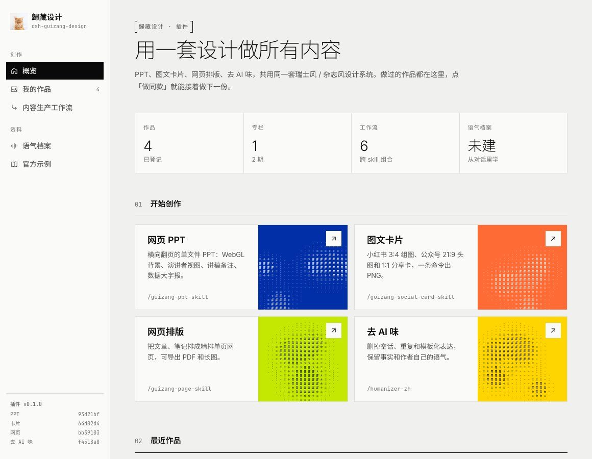

# 歸藏设计 · dsh-guizang-design

DeepSeek Harness（dsh）插件。把歸藏的四个 skill 装进 dsh，并在侧栏加一个「歸藏设计」页面：

- **网页 PPT**（guizang-ppt-skill）、**图文卡片**（guizang-social-card-skill）、**网页排版**（guizang-page-skill）、**去 AI 味**（humanizer-zh）。前三个共用一套设计系统：同样的杂志风 / 瑞士风主题、字号、字体和背景特效，品牌色按色彩科学生成受约束的主题。
- **作品库**：官方示例和你做过的作品。每份作品都可以「做同款」：在新对话里按这份作品的主题和版式填好草稿，补上内容就能发。
- **内容生产工作流**：跨 skill 的常用组合——一篇文章三种出口、先去 AI 味再排版、演讲回收、品牌套件、封面矩阵、中英双版本。
- **专栏**：连载的各期放在一起，一键做新一期，沿用上一期的主题和版式。
- **语气档案**（guizang-voice）：读你在 DeepSeek 里发过的消息（尤其是大段的文字），也可以补充你写过的文章，学出你的写作习惯，存成本机的一份档案。去 AI 味时保留你本来的说法，让 AI 仿写时照着你的语气写。



## 安装

需要 dsh 0.2.1 以上和 pnpm。

```bash
dsh plugin --profile web add github:op7418/dsh-guizang-design
# dsh web 正在运行的话，重启后刷新页面
```

图文卡片出图用 Playwright 的 Chromium。第一次出图如果提示缺少浏览器，运行 `npx playwright install chromium`。网页导出 PDF / 长图用本机的 Chrome。

## 使用

- 侧栏点「歸藏设计」打开插件页面；点 skill 卡片、「使用工作流」「做同款」会开一个新对话并填好草稿。
- 语气档案页点「从我的 DeepSeek 对话学习」：插件把你在 DeepSeek 里发过的消息整理成学习素材，开一个新对话让 AI 建档，学完的档案显示在这一页。
- 也可以在输入框里直接打 `/guizang-ppt-skill`、`/guizang-social-card-skill`、`/guizang-page-skill`、`/humanizer-zh`、`/guizang-voice`。
- skill 交付作品后会自己登记进作品库；手动登记：

  ```bash
  node <插件目录>/scripts/library.mjs add <HTML 文件或卡片任务目录> --skill guizang-ppt-skill --title "标题" [--column "专栏名"]
  ```

你在 `~/.dsh/skills` 或项目里装了同名 skill 时，那一份优先，插件自带的这份让位。

## 数据放在哪

作品库、缩略图和语料档案都在 `$DSH_HOME/guizang-design/`（默认 `~/.dsh/guizang-design/`），只在本机。作品库只记路径，不复制作品文件；移出作品库也不会删除文件。

## 开发

- `skills/` 是四个独立仓库的快照（`skills/manifest.json` 记着来源和提交），不要直接改：改各自的仓库，再运行 `node tools/vendor-skills.mjs`。
- `examples/` 由 `node tools/vendor-examples.mjs <guizang-design 路径>` 从设计系统仓库的 demo 生成。
- `gallery/gz-swiss.css`（瑞士风的颜色、字体、间距 token）由设计系统生成（`guizang-design/scripts/sync-skill.mjs studio <本仓库>`）。
- `npm test` 跑插件自己的测试；本地调试：`dsh plugin --profile web add link:$PWD`。

## License

AGPL-3.0。打包的 skill 各自带着自己的 LICENSE（humanizer-zh 是 MIT）。
